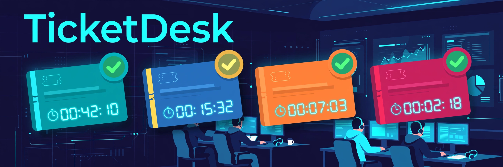

# TicketDesk



A helpdesk ticketing system built with ASP.NET Core. Tickets flow from requesters to agents with
per-priority SLA timers, workload-balanced auto-assignment, internal notes, and a full audit trail.

## Features

- **Ticket CRUD** — title, description, priority (Low/Medium/High/Critical), status (Open → In Progress → Resolved → Closed)
- **Role-based authorization** — Requester / Agent / Admin roles enforced with `[Authorize(Roles=...)]`;
  requesters only see and edit their own tickets
- **SLA timers** — due dates computed per priority (Critical 4h, High 8h, Medium 24h, Low 72h);
  breach and near-breach (< 25% of window left) detection with a dedicated `/api/tickets/sla/breaches` endpoint
- **Assignment queues** — one-click auto-assign routes to the least-loaded agent; per-agent workload view
  (open / in-progress / overdue counts)
- **Comments & audit** — public replies plus agent-only internal notes; every create/update/assign/comment
  is recorded in an audit trail

## Tech stack

- ASP.NET Core 8 Web API, EF Core + SQLite (database file created and seeded at startup)
- xUnit + `WebApplicationFactory` integration tests (EF Core InMemory)

## How to run

```bash
dotnet run --project src/TicketDesk.Api
```

The API listens on `http://localhost:5000` (or the port shown in the console).

Demo auth: pass the `X-Demo-User` header with one of the seeded user ids — the API prints them
at startup, or grab them from `src/TicketDesk.Api/Data/SeedData.cs`. Swap `DemoAuthHandler`
for JWT/OIDC in production; the authorization attributes stay the same.

```bash
# list tickets as the seeded requester
curl -H "X-Demo-User: 11111111-1111-1111-1111-111111111111" http://localhost:5000/api/tickets
```

## How to test

```bash
dotnet test
```

## Project layout

```
src/TicketDesk.Api/
  Models/        Ticket, AppUser, TicketComment, TicketAuditEntry, enums
  Data/          EF Core DbContext + seed data (4 demo users)
  Services/      SlaService (due dates, breach detection), AssignmentService (auto-assign, workload)
  Auth/          DemoAuthHandler (header-based demo auth with role claims)
  Controllers/   TicketsController, UsersController
tests/TicketDesk.Tests/
  SlaServiceTests, AssignmentServiceTests, TicketApiTests (full HTTP integration)
```
